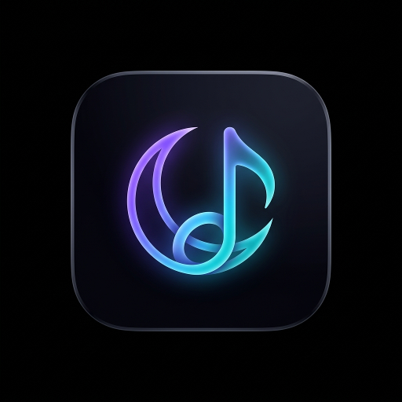
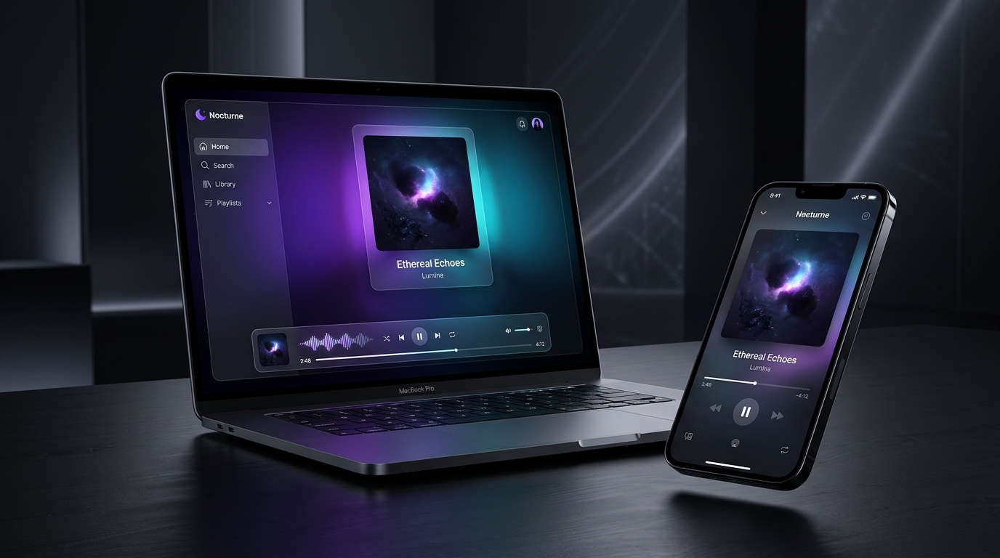
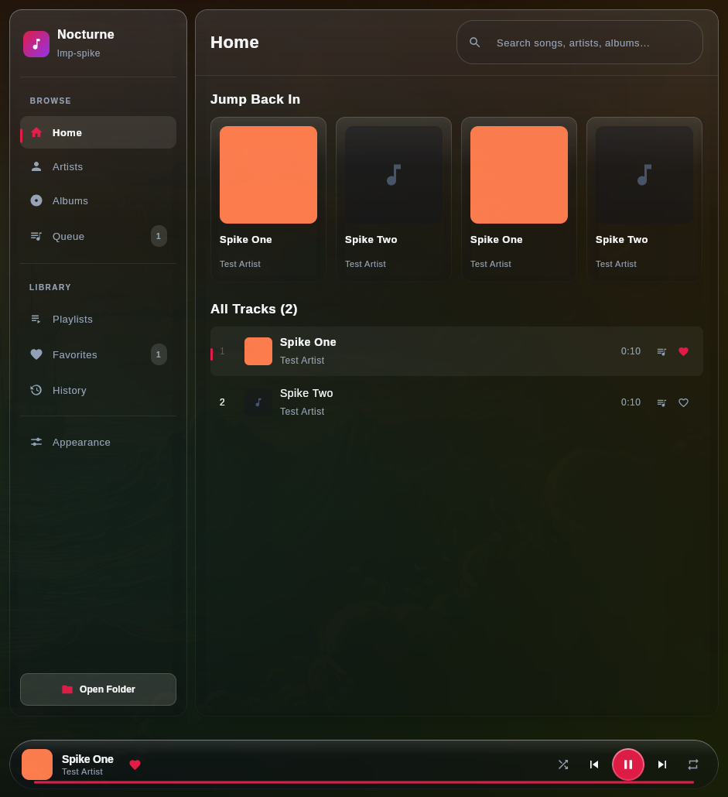
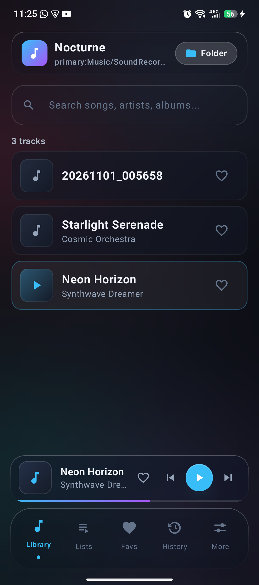

<p align="center">
  
</p>

<h1 align="center">Nocturne</h1>

<p align="center">
  A clean, fast, offline local music player with a calm, Liquid Glass interface for Android and Desktop.
</p>

<p align="center">
  <a href="https://github.com/musgandapur645-sudo/Nocturne/releases"></a>
  <a href="LICENSE"></a>
  <a href="https://kotlinlang.org/lp/multiplatform/"></a>
  <a href="https://www.jetbrains.com/compose-multiplatform/"></a>
  <a href="#permissions"></a>
</p>

<p align="center">
  <a href="#features">Features</a> · 
  <a href="#download">Download</a> · 
  <a href="#project-structure">Project Structure</a> · 
  <a href="#build-locally">Build Locally</a> · 
  <a href="#contributing">Contributing</a>
</p>

<p align="center">
  
</p>

---

## Overview

**Nocturne** brings music playback, local library scanning, and customizable themes together in a unified cross-platform player for Android and Desktop. 

Built from the ground up with Kotlin Multiplatform, Compose Multiplatform, and Media3, Nocturne pairs high-performance local playback with a refined **Liquid Glass** aesthetic: dynamic ambient mesh gradients derived from ID3 album art, frosted translucent surfaces, and tactile Cupertino-inspired controls.

---

## Features

### 🎵 Playback & Audio
- **Local-Only Audio Engine**: Fast, gapless playback for MP3, OGG, and WAV files.
- **Background Playback**: Background audio with notification media controls, lock screen controls, and automatic audio focus handling (unplugging headphones pauses audio).
- **Audio Queue & Mixes**: Dynamic queue management with "Up Next", shuffle, repeat modes, and seek scrubbing.
- **Smart Directory Scanner**: Automatically indexes folders via system pickers without broad storage permissions.

### 🪟 Liquid Glass Interface
- **Ambient Artwork Mesh**: Real-time ambient 4-blob mesh gradient backdrop extracted from embedded album art using color palette analysis.
- **Cupertino Controls**: Custom spring-bounce glass buttons, capsule toggles (Shuffle, Repeat, Favorite), and tactile seek sliders.
- **Refractive Frosting**: Integrated Haze blur system across headers, floating mini-player docks, and bottom navigation.
- **Smooth Splash Transition**: Luminous spring icon entrance animation on app launch.

### 📋 Library & Organization
- **Playlists & Mixes**: Create, rename, delete, and curate custom playlists.
- **Favorites & Loved Tracks**: Instant one-tap bookmarking with quick-access tabs.
- **Listening History**: Track recent plays with resume, pause, and clear controls.
- **Instant Search**: Real-time query filtering with keyboard navigation and shortcut support.

### 🔒 Privacy & Architecture
- **100% Offline**: No network requests, zero telemetry, no third-party trackers, no analytics.
- **Safe Storage**: Uses Android SAF (Storage Access Framework) and app-private storage only.
- **Deterministic Persistence**: Coroutine-backed FIFO serialization ensures playlists, history, and theme settings never corrupt.

---

## Screenshots

<p align="center">
  
</p>
<p align="center">
  
</p>

---

## Download

### Android
- **Pre-built APK**: Download the latest `androidApp-debug.apk` from [GitHub Releases](https://github.com/musgandapur645-sudo/Nocturne/releases).
- Compatible with **Android 8.0 (API 26)** and later.

### Desktop (Linux, macOS, Windows)
- **Standalone Runnable Jar**: Requires [Java 21+](https://adoptium.net/):
  ```bash
  java -jar desktopApp-runnable.jar
  ```
- **Thin Distribution**: Packaged archive with companion libraries for minimal memory footprint.

---

## Project Structure

Nocturne is organized as a clean Gradle multiplatform workspace:

| Path | Responsibility |
| :--- | :--- |
| **`androidApp/`** | Android application entry point (`MainActivity`), background `PlaybackService` (Media3/ExoPlayer), adaptive launcher icons, and Android-specific Liquid Glass layout. |
| **`desktopApp/`** | Desktop Compose Multiplatform application (`MainKt`), Java Sound playback pipeline, keyboard shortcuts, window controls, and jar/native packaging tasks. |
| **`shared/`** | Kotlin Multiplatform shared core: data models (`TrackView`, `Playlist`), state snapshot (`LocalPlayerSnapshot`), settings codecs, and FIFO Channel file persistence. |
| **`assets/`** | Master branding assets, logos, and high-resolution commercial showcase graphics. |
| **`screenshots/`** | Real device and desktop verification captures for store listings and documentation. |

---

## Build Locally

### Prerequisites
- **JDK 21** or later (e.g., Eclipse Temurin 21)
- **Android SDK** (API 34+ / 37 installed, for Android builds)
- **Git**

### Clone & Build

```bash
# Clone the repository
git clone https://github.com/musgandapur645-sudo/Nocturne.git
cd Nocturne

# Build Android APK
./gradlew :androidApp:assembleDebug

# Run Desktop app directly
./gradlew :desktopApp:run

# Build Desktop standalone runnable fat jar
./gradlew :desktopApp:runnableJar
```

> **Windows Users:** Use `.\gradlew.bat` in PowerShell / Command Prompt.  
> Ensure your Android SDK path is declared in `local.properties`:
> ```properties
> sdk.dir=C:/Users/<Username>/AppData/Local/Android/Sdk
> ```

---

## Keyboard Shortcuts (Desktop)

| Shortcut | Action |
| :--- | :--- |
| **`Space`** | Play / Pause (yields when typing in search) |
| **`Ctrl / Cmd + →`** | Skip to next track |
| **`Ctrl / Cmd + ←`** | Return to previous track |
| **`Escape`** | Clear search field & reset focus |
| **`Enter`** | Play selected track |

---

## Contributing

Contributions, bug reports, and suggestions are welcome!
1. Check the [Code of Conduct](CODE_OF_CONDUCT.md).
2. Report vulnerabilities confidentially per [SECURITY.md](SECURITY.md).
3. Open a Pull Request with clear commit messages and test verification.

---

## Security

Nocturne is designed with strict least-privilege principles:
- **No INTERNET permission** requested on Android or Desktop.
- All file access is restricted to user-chosen directories via SAF or file pickers.
- All configuration is kept strictly in app-private sandboxed directories.
- See [SECURITY.md](SECURITY.md) for full policy details.

---

## License

Nocturne is open source software licensed under the [Apache License 2.0](LICENSE).

---

<p align="center">
  Maintained with care by <a href="https://github.com/musgandapur645-sudo">Aluu826</a>
</p>
