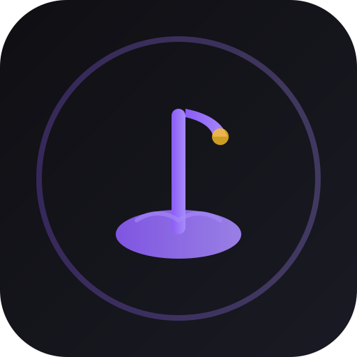

<p align="center">
  
</p>

<h1 align="center">Nocturne</h1>

<p align="center">
  A clean, fast, offline local music player for Android and Desktop
</p>

<p align="center">
  
  
  
  
</p>

## Features

- 🎵 **Local-Only Playback** - Play MP3, OGG, and WAV files from your local music library
- 📁 **Smart Scanning** - Automatically scan selected folders, filters out unsupported formats like FLAC
- 📋 **Playlists** - Create, manage, and play custom playlists
- ❤️ **Favorites** - Mark your favorite tracks for quick access
- 📜 **Listening History** - Track your listening history with pause/resume/clear controls
- 🎨 **Customizable Themes** - Multiple presets, accent colors, and glass intensity effects
- ⌨️ **Keyboard Shortcuts** - Space to play/pause, arrow keys for navigation, Escape to clear search
- 🔍 **Search & Filter** - Quickly find tracks in your library
- 💾 **Persistent State** - Playlists, favorites, history, and settings saved across restarts
- 🔒 **Privacy First** - 100% offline, no network access, no telemetry or data collection
- 🎧 **Background Playback** - Android supports background playback with media controls

## Screenshots

*Screenshots coming soon. See `assets/` directory for logos and icons.*

## Installation

### Desktop (Linux, macOS, Windows)

#### Option 1: Download Pre-built Release
1. Download `nocturne-thin-dist.zip` from the [releases page](../../releases)
2. Extract the archive
3. Run with Java 21+:
   ```bash
   java -jar nocturne/desktopApp-thin.jar
   ```
   Or use the runnable fat jar:
   ```bash
   java -jar desktopApp-runnable.jar
   ```

#### Option 2: Build from Source
See [Building from Source](#building-from-source) below.

### Android

#### Option 1: Build APK
```bash
./gradlew :androidApp:assembleDebug
```
APK will be at `androidApp/build/outputs/apk/debug/androidApp-debug.apk`

#### Option 2: Install from Release
Download the APK from releases and install on your device.

## Building from Source

### Prerequisites
- [JDK 21](https://adoptium.net/) or later
- [Android SDK](https://developer.android.com/studio) (for Android builds)
- Git

### Clone and Build

```bash
# Clone the repository
git clone https://github.com/yourusername/nocturne.git
cd nocturne

# Build desktop
./gradlew :desktopApp:packageDistributive

# Build Android
./gradlew :androidApp:assembleDebug

# Run desktop app
./gradlew :desktopApp:run
```

### Windows notes

Use `gradlew.bat`, and create `local.properties` with your SDK path (it is gitignored):

```properties
sdk.dir=C:/Users/<you>/AppData/Local/Android/Sdk
```

## Usage

### Desktop
1. Launch the app
2. Click "Open Music Folder" to select your music directory
3. Browse your library, create playlists, and enjoy your music
4. Use keyboard shortcuts for faster navigation:
   - `Space` - Play/Pause
   - `←/→` (with Ctrl/Cmd) - Previous/Next track
   - `Escape` - Clear search
   - `Enter` - Play selected track

### Android
1. Install and launch the app
2. Grant folder access via SAF picker
3. Browse and play your music
4. Use media controls in notifications for background playback

## Architecture

- **Kotlin Multiplatform** - Shared business logic across platforms
- **Compose Multiplatform** - Declarative UI for Android and Desktop
- **ExoPlayer** (Android) - Robust media playback
- **Java Sound API** (Desktop) - Native audio playback via jaudiotagger
- **Coroutines & Flow** - Reactive state management

## Permissions

### Android
- Uses SAF for folder access (no broad storage permissions required)
- FileProvider restricted to app-private storage only
- No network, camera, or location permissions

### Desktop
- Requires read access to selected music folders

## Privacy & Security

- **100% Offline** - No internet connection required or used
- **No Data Collection** - No analytics, tracking, or telemetry
- **Local Storage Only** - All data stored on your device
- **Least Privilege** - Minimal permissions requested
- See [SECURITY.md](SECURITY.md) for more details

## Contributing

We welcome contributions! Please read our [Code of Conduct](CODE_OF_CONDUCT.md) before contributing.

1. Fork the repository
2. Create a feature branch (`git checkout -b feature/amazing-feature`)
3. Commit your changes (`git commit -m 'Add amazing feature'`)
4. Push to the branch (`git push origin feature/amazing-feature`)
5. Open a Pull Request

## License

This project is licensed under the Apache License 2.0 - see the [LICENSE](LICENSE) file for details.

## Acknowledgments

- Built with [Kotlin Multiplatform](https://kotlinlang.org/lp/multiplatform/)
- UI powered by [Compose Multiplatform](https://www.jetbrains.com/compose-multiplatform/)
- Audio playback with [ExoPlayer](https://developer.android.com/media/media3/exoplayer) and [jaudiotagger](http://www.jthink.net/jaudiotagger/)

## Status

**v0.1.0** - Phase 1 & 2 Complete  
Phase 1: Core playback, playlists, history, persistence ✓  
Phase 2: Android polish, desktop UX, settings resilience, packaging ✓


## Screenshots

<p align="center">
  
</p>
